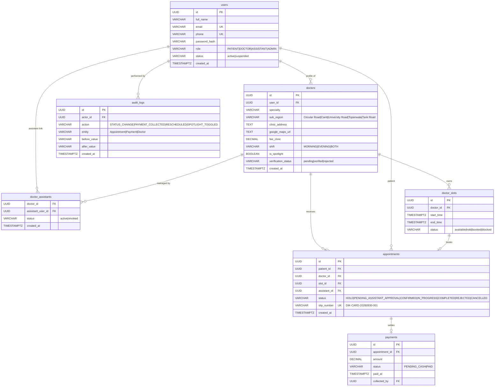

# D.I. Khan Doctor Appointment System — System Design & Architecture

## 1. High-Level Architecture Overview

The **D.I. Khan Doctor Appointment System** is a modern, high-throughput, multi-tier healthcare platform tailored for clinics and polyclinics in Dera Ismail Khan (D.I. Khan).

```
                                  +-------------------------------------------------+
                                  |                 Client Layer                    |
                                  |   (React 18 + TypeScript + Vite + Tailwind CSS) |
                                  +-----------------------+-------------------------+
                                                          |
                                           HTTPS / REST   |   WSS (Realtime Events)
                                                          v                     v
+-----------------------------+           +---------------+----+     +----------+----------+
|      Redis In-Memory Layer  |           |     FastAPI Server |     | Supabase PostgreSQL |
|  - 10-Min Slot Locks (NX)   |<--------->|  - Python 3.11/3.13|     | - ACID Relational DB|
|  - Rate-Limited OTPs (TTL)  |           |  - Async SQLAlchemy|<--->| - Row Level Security |
|  - Directory Cache          |           |  - Pydantic v2     |     | - Realtime Streams  |
|  - Active Sessions          |           |  - Argon2 / JWT    |     | - Unique Constraints|
+-----------------------------+           +--------------------+     +---------------------+
```

---

## 2. Core Architectural Components

### A. Frontend Layer (Single Page Application)
- **Framework:** React 18 with TypeScript via Vite for fast HMR and optimized production bundles.
- **Styling & Design System:** Tailwind CSS with a curated healthcare palette:
  - Primary: Deep Emerald & Medical Teal (`#0F766E`, `#14B8A6`, `#042F2E`)
  - Accent: Amber / Gold for Spotlight Doctor badges (`#F59E0B`)
  - Neutral / Dark Mode: Slate/Zinc high-contrast surfaces (`#0F172A`, `#1E293B`)
- **State & Data Synchronization:**
  - **TanStack Query (React Query):** Client-side caching, background refetching, and optimistic updates.
  - **Supabase Realtime JS Client:** WebSocket connection listening directly to PostgreSQL replication stream for instantaneous queue updates.
- **Portals:**
  1. *Patient Portal:* Discovery, sub-region filter, slot picker, OTP dialog, digital slip tracker.
  2. *Assistant Desk:* Live appointment queue, multi-doctor polyclinic switcher, rescheduling modal, cash drawer.
  3. *Doctor Portal:* Shift and schedule calendar, self-service assistant credentials, analytics.
  4. *Admin Control Center:* Spotlight toggle, doctor verification, audit logs, Redis cache inspector.

### B. High-Speed In-Memory Layer (Redis)
- **Distributed Concurrency Slot Lock:**
  - Key: `slot:lock:{slot_id}`
  - Command: `SET slot:lock:{slot_id} {patient_id} NX EX 600`
  - Prevents race conditions during the 10-minute booking/verification window before touching PostgreSQL.
- **Verification Engine & Rate Limiter:**
  - Key: `otp:{phone_or_email}` -> Stores Argon2-hashed code with `EX 600` (10-minute validity).
  - Key: `otp:attempts:{phone_or_email}` -> Sliding-window counter with `INCR` and `EX 900` (max 3 tries per 15 minutes).
- **Directory & Spotlight Cache:**
  - Key: `cache:doctors:{sub_region}:{specialty}:{shift}` with 5-minute TTL.
  - Invalidated atomically when doctor profile changes or Admin toggles Spotlight.

### C. Application Backend (FastAPI)
- **Runtime:** Python 3.11+ / 3.13 asynchronous ASGI service.
- **ORM & DB Access:** SQLAlchemy 2.0 with asynchronous engine (`asyncpg`).
- **Data Validation:** Pydantic v2 with strict type coercion.
- **Security & Cryptography:**
  - Passwords: Argon2id (via Passlib / CryptContext).
  - Tokens: RS256 / HS256 JWT access and refresh tokens.
  - OTP verification: Argon2 hashed comparison.

### D. Persistent Storage & Event Streaming (PostgreSQL via Supabase)
- **ACID Transactions:** Financial and appointment status integrity.
- **Anti-Collision Guard:** Composite unique constraint `UNIQUE (doctor_id, start_time)` on `doctor_slots`.
- **Change Data Capture (CDC):** Supabase Realtime publication on `appointments` and `payments` tables streaming changes directly to connected Assistant Desks and Patient Dashboards.

---

## 3. Database Schema Design (ERD)



---

## 4. Workflows & State Machines

### A. Patient Booking & OTP Flow
```
[Patient Selects Slot]
         |
         v
[Redis Atomic Lock]: SET slot:lock:{id} {patient} NX EX 600
  |-- Collided? -> Reject with "Slot temporarily held by another patient"
  +-- Succeeded? -> Proceed
         |
         v
[Redis OTP Generation]: 6-digit code -> Argon2 hash -> Redis (TTL 600s)
         |
         v
[Patient Verifies Code in UI]
  |-- Exceeded 3 tries in 15m? -> Lockout error
  |-- Invalid? -> Increment attempts
  +-- Valid? ->
         |
         v
[Database]: Appointment row created (status: PENDING_ASSISTANT_APPROVAL)
[Supabase Realtime]: Pushed immediately to Assistant Desk queue
```

### B. Assistant Review & Digital Slip Issuance
```
[Assistant Desk Queue] (Realtime WebSocket)
         |
         +--> [Slot Available?]
                 |-- NO --> Propose Alternate Slot + Send Note
                 +-- YES -> Approve Booking
                                 |
                                 v
                     status -> CONFIRMED
                     payment_status -> PENDING_CASH
                     slip_number -> Generated (e.g. DIK-CIRC-20260930-014)
                                 |
                                 v
                     [Patient Dashboard Updates Instantly]
```

### C. Cash Desk Payment Processing
```
[Patient Arrives at Clinic Desk with Digital Slip]
         |
         v
[Assistant Searches Slip Number or Selects Confirmed Queue Item]
         |
         v
[Patient Pays Cash] -> Assistant clicks [Mark as Paid]
         |
         v
payments.status -> PAID
payments.paid_at -> now()
payments.collected_by -> assistant_user_id
audit_logs -> Created with Actor, Before ('PENDING_CASH'), After ('PAID')
         |
         v
[Patient Dashboard & Doctor Analytics Update in Realtime]
```

---

## 5. Security & Concurrency Design

1. **Double-Booking Elimination:**
   - **Level 1 (Memory):** Redis distributed key with expiration eliminates simultaneous click collisions.
   - **Level 2 (Database):** PostgreSQL composite unique index `UNIQUE (doctor_id, start_time)` blocks duplicate inserts unconditionally.
2. **Brute-Force OTP Protection:**
   - Sliding-window rate limiting via Redis atomic counters blocks automated guessing.
3. **Role-Based Access Control (RBAC):**
   - Protected API dependencies inspect JWT payload claims (`role IN ('ADMIN', 'DOCTOR', 'ASSISTANT', 'PATIENT')`).
   - Doctor endpoints enforce ownership: doctors can only modify their own assistants, slots, and blackouts.
   - Assistant endpoints enforce doctor-linkage verification: assistants can only view and manage queues for linked doctors.
